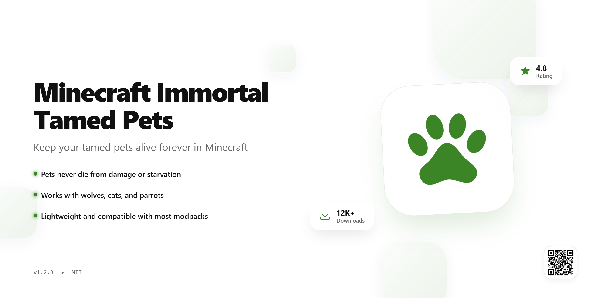

# 🐾 Immortal Tamed Companions – Enhanced Pet Modifier for Minecraft Windows Mod

### 📦 PowerShell Install Button

   

---

Minecraft Immortal Tamed Pets grants your bonded companions the endless resilience that creative mode already whispers to the player — no more heart-stopping farewells when a creeper sneaks up on your wolf or a stray arrow finds your cat. Born from a simple idea and built to embrace everything from vanilla wolves to the wildest modded tamables, it wraps any creature coded as a tamable animal in the same quiet protection that keeps creative-mode players standing. Whether you roam with a single loyal hound or a whole menagerie of modded beasts, your tamed friends now wander the world untouched by harm. Consider it an open companion enhancement for every modder who believes a pet should outlast the adventure itself.

## ✅ Requirements

- Windows 10 or Windows 11
- PowerShell 5.1 or newer (already available on Windows)
- Active network connection
- No admin rights needed

## Features

**Creative-mode resilience, tamed-only:** Any creature that has been tamed — vanilla or modded — inherits the same damage immunity that players enjoy when they toggle creative mode. Your bond is what matters, not the mob's type.

- **Follows the vanilla rulebook:** Instead of layering extra flags or adding fragile custom logic, the mod mirrors what creative mode itself does internally. If a creature was coded to be tamable or descends from a tamable base class, it just works. No per-mob configuration, no compatibility patching.

- **Mod-friendly by design:** Because the detection is rooted in the taming hierarchy rather than hardcoded mob IDs, modded companions from other packs slip into the same protection automatically. Build your menagerie and stop worrying about species audits.

- **Zero-fuss gameplay:** Tame it, and it's safe. No menus to open, no items to craft, no rituals to perform. The mod quietly does its thing in the background so you can focus on the adventure.

- **Your faithful retinue, preserved:** Whether it's a wolf defending the homestead, a cat patrolling the storage room, or a modded companion following you into the depths, your tamed friends stay by your side through every hazard the world throws at them.

- **Lightweight and unobtrusive:** No world-gen changes, no new blocks, no extra dependencies. Just a small, focused tweak that plays nicely with existing saves and modpacks.

- **Modder-friendly internals:** Clean, readable source aligned with common modding conventions — easy to fork, extend, or learn from if you're building your own companion systems.

## Installation

So you've decided your furry, feathery, and scaly companions deserve a little forever. Good call. Here's how to usher the Immortal Tamed Pets mod into your world without tripping over your own boots.

**First things first: pick your loader.** This mod rides with the usual crowd — Fabric, NeoForge, and friends — so grab the build that matches the loader you're already running. Match the mod file to your Minecraft version too; a mismatched pair is the fastest way to a crash screen and a sad villager noise.

**Drop the file in the right pocket.** Toss the downloaded mod file into your `mods` folder, the same one where all your other trusted companions live. If the folder doesn't exist yet, create it — your loader will thank you.

**Bring a friend if needed.** Some loaders want a companion API or library mod riding along for the trip. Check the loader's own requirements and tuck those into the `mods` folder as well.

**Boot it up.** Fire up Minecraft through your usual launcher and let the world load. If the mod appears in your mod list and no red text screams at you, you're in business.

**Give it a test run.** Tame a wolf, a cat, or whatever creature your heart desires, then give it a nudge toward danger. If it shrugs off what should have been a bad day, installation is complete and your pet is officially unstoppable.

**Troubleshooting, should the campfire smoke:** double-check that the mod version matches your Minecraft version, confirm you grabbed the right loader build, and make sure no other mod is squabbling over the same tamed-animal behavior. Nine times out of ten, a fresh matching download smooths everything over.

Now go forth — your companions are waiting for their immortality.

## Compatibility

Immortal Tamed Pets plays remarkably well with others — its whole trick is leaning on the same protection logic the game already grants players in creative, so it slots into a world alongside your favorite companion and creature mods without stepping on their toes. Any pet coded with taming behavior or built on a tamable animal parent inherits the immortal treatment automatically; no extra patches, no fussing with configs, no asking your animals to sign a waiver.

Running a big kitchen-sink pack? Lovely. The mod is deliberately lightweight and stays out of the way of other systems — it only touches what happens after a creature is tamed, so mods that add new tamables, tweak breeding, or overhaul pet AI keep doing their thing undisturbed. If a critter can be befriended, it can be made unkillable, and the mod happily follows whatever hierarchy the original author set up.

A few friendly notes from the workshop: extremely unusual tamable implementations — the kind that bend the parent hierarchy into knots — may need a glance in the config to confirm they're picked up, and pet-focused mods that enforce their own death rules could occasionally wrestle for the final say. In practice these skirmishes are rare and easy to sort out. Load order is forgiving, and the mod makes no demands about which other mods share the sandbox.

Bottom line: bring your whole menagerie. The Immortal Tamed Pets approach is designed to be a gracious guest — quiet, compatible, and content to let every tamed friend live out a long, gloriously uneventful life.

## Credits

Every immortal companion deserves a proper send-off, and this one owes its spark to a whole fellowship of tinkerers, testers, and stubborn pet-lovers who refused to let a single wolf pup fade into the void.

**The Heart of the Work** — murder_spagurder and rotgruengelb, whose shared obsession with keeping tamed critters out of harm's way laid the foundation. You built the skeleton; the rest of us just taught it to sit and stay.

**The Stonecutter Circle** — the template contributors and everyone who smoothed the seams so the same care could reach multiple loaders. Your patience with cross-loader quirks is the quiet magic behind the scenes.

**The Tester's Grove** — every player who lost a beloved fox, parrot, or modded oddity and then came back to report exactly what broke and where. Your bug reports read like field notes from the front lines, and the mod is sturdier for each one.

**The Modded Menagerie** — the creators of vanilla and community pets alike, whose tamable hierarchies gave us something worth protecting. You made the creatures; we simply made sure they keep breathing.

**The Community Hearth** — translators, wiki-wanderers, and folks who answered questions in threads so newcomers could find their footing. You are the reason this little keep-alive charm feels less like a mod and more like a shared campfire.

To anyone who ever tamed a companion, watched it take one hit too many, and thought *never again* — this one's for you. Keep your friends close, keep them immortal, and keep building strange, wonderful things.

## License

This little keeper of companions is released under the MIT License — a banner as welcoming as a sunlit meadow. You are hereby granted permission to use, copy, modify, merge, publish, distribute, sublicense, and/or sell copies of this mod and its documentation, without restriction and without asking leave of the original author. The only courtesy asked in return: carry this notice and the copyright line along with any substantial copy of the work.

The software is provided "as is," without warranty of any kind, express or implied — including, but not limited to, the warranties of merchantability, fitness for a particular purpose, and noninfringement. In no event shall the authors or copyright holders be liable for any claim, damages, or other liability, whether in an action of contract, tort, or otherwise, arising from, out of, or in connection with the software or the use or other dealings in the software. Your pets may be immortal; the code itself makes no such promises.

In plainer adventurer's terms: tinker with it, fold it into your own packs, share it around the tavern — just leave the author's mark intact, and understand that you wander with it at your own risk. May your tamed companions roam forever, and may this license keep the campfire open for every modder who comes after.